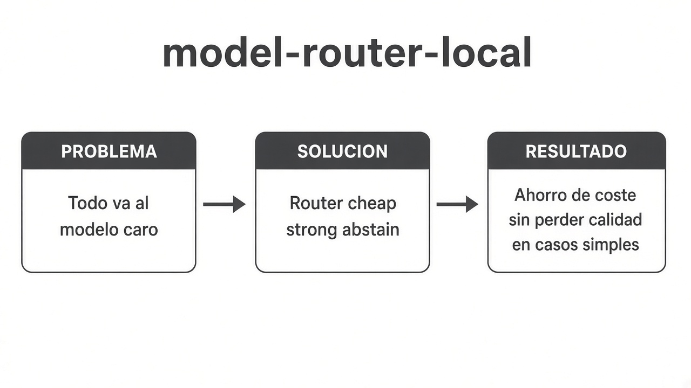
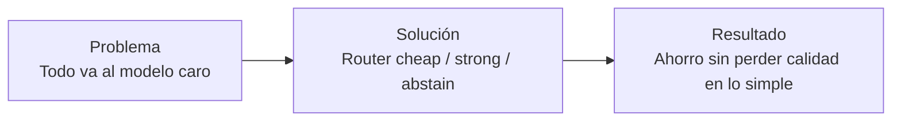

<div align="center">

# model-router-local

**Router cheap / strong / abstain** · Angel Salazar

<br/>


</div>

---

### `$ cat diagrama.md`



---

### `$ cat problema.md`

Mandar todo a Sonnet/Opus sale caro.  
Clasificamos la query y elegimos modelo (o abstenerse).

---

```bash
pip install -e .
pytest
python -m model_router route "¿Cuál es el límite comercial?"
python -m model_router bench
```

---

Hecho en Lima · Angel Salazar · CIP 404730
